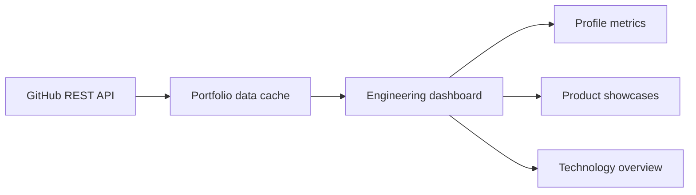

# GitHub Engineering Dashboard

A client-facing engineering portfolio with searchable project case studies,
public GitHub statistics, and a direct path to discuss work with Ayoub Odf.

**Live showcase:** [ayoubodf-dev.github.io/github-api-portfolio-showcase](https://ayoubodf-dev.github.io/github-api-portfolio-showcase/)


## Highlights

- Six curated web, mobile, desktop, and automation project showcases
- Search and category filters, with accessible project-detail dialogs
- Live public GitHub statistics and a repository language summary
- Browser caching for 15 minutes and a graceful API-unavailable state
- Responsive desktop, tablet, and mobile layouts
- A clear delivery process and Fiverr contact links

Project-card illustrations are labeled as interface concepts, not product
screenshots. Project documentation and available media are linked separately.

## Local preview

Serve this directory with a static HTTP server, for example:

```sh
python3 -m http.server 8769 --bind 127.0.0.1
```

No build step, secret, GitHub token, or private repository access is required.

## Architecture



## Source availability

This repository contains the public showcase interface, documentation, and
demonstration media. Underlying product implementations and the separate server
dashboard remain private and proprietary.

Copyright © 2026 Ayoub Odf. All rights reserved.
