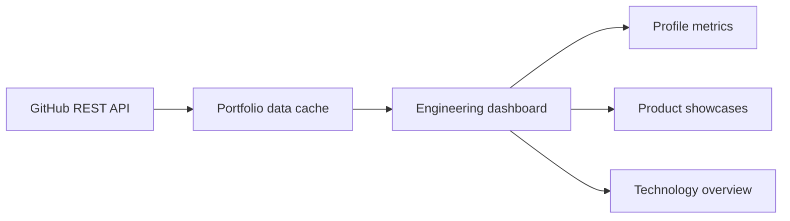

# GitHub Engineering Dashboard

A portfolio dashboard that turns GitHub REST API data into a focused view of
repositories, technologies, activity, and engineering projects.

## Highlights

- Live GitHub profile and repository statistics
- Featured-product metadata
- Language and platform summaries
- Responsive portfolio presentation
- Rate-conscious API caching

## Architecture

## Source availability

The current implementation is private and proprietary. This public repository
contains product documentation and demonstration media only.

Copyright © 2026 Ayoub Odf. All rights reserved.
